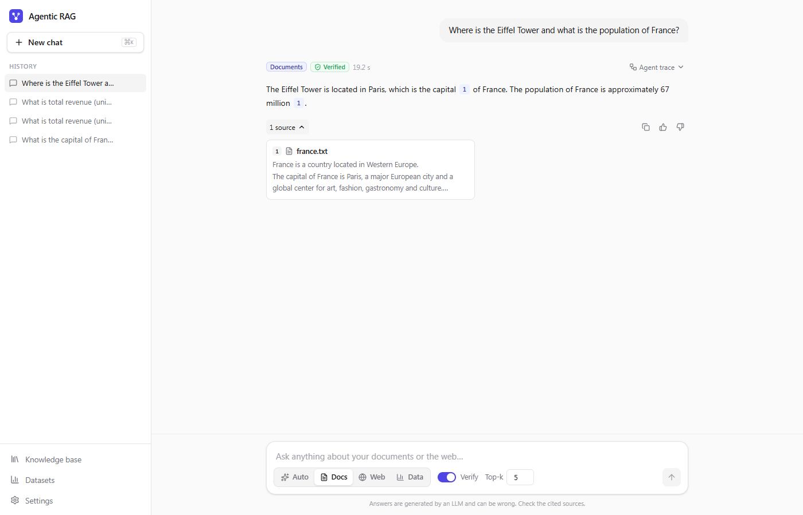
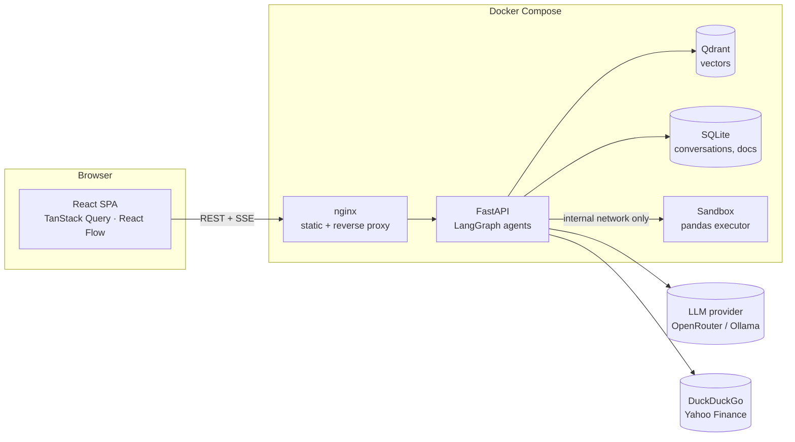
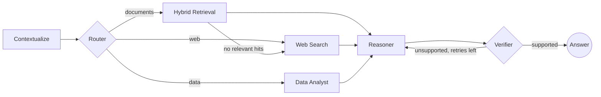
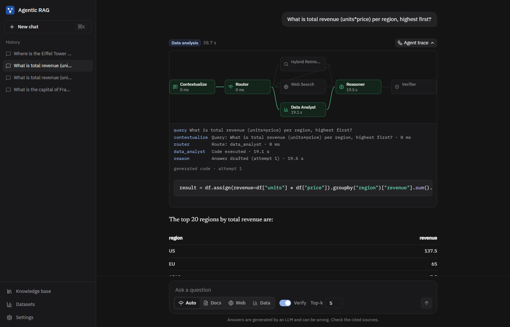

# Agentic RAG

A multi-agent **Retrieval-Augmented Generation** system: a team of specialised agents, orchestrated with **LangGraph**, that retrieves from your documents, searches the web, analyses spreadsheets in a sandbox, and fact-checks its own answers before you see them.

**FastAPI** · **LangGraph** · **React 19 + TypeScript** · **Qdrant** · **Docker Compose**. Works with free OpenRouter models or fully offline with Ollama.



---

## Highlights

- **Hybrid retrieval:** dense embeddings and BM25 keyword search, merged with Reciprocal Rank Fusion and reranked by a cross-encoder.
- **Self-correcting answers:** an LLM-as-judge Verifier checks every claim against the sources. When it rejects an answer, the Reasoner regenerates it using the verifier's feedback.
- **Inline citations:** answers cite `[1]`, `[2]`… and each citation opens the exact passage (with page number for PDFs).
- **Live agent trace:** every agent's start, finish, logs and timing stream to the UI over Server-Sent Events, rendered as an animated graph. Answers stream token by token.
- **Sandboxed data analysis:** the Data Analyst writes pandas code and runs it in an isolated container (no network, read-only filesystem, CPU/memory/time limits). If the code fails, the error goes back to the LLM for a self-repair attempt.
- **Smart routing:** cheap retrieval signals decide documents vs. web first. The LLM is consulted only for ambiguous queries.
- **Provider-agnostic LLM:** any OpenAI-compatible endpoint works (OpenRouter, Ollama, vLLM, OpenAI), switched with one environment variable.
- **Production basics:** API-key auth, rate limiting, upload validation (magic bytes, zip-bomb and path-traversal guards), structured JSON logs with trace IDs, Prometheus metrics, health/readiness probes, CI.

## Architecture



### The agent graph



| Agent | What it does |
|---|---|
| **Contextualize** | Rewrites follow-ups ("what about its population?") into standalone questions. Skipped when there is no history. |
| **Router** | Uses semantic and BM25 relevance scores plus live-information keywords to choose documents or web search. Falls back to an LLM classifier only when the signals are ambiguous. |
| **Hybrid Retrieval** | Dense search (MiniLM embeddings) and BM25, fused with RRF and reranked by a cross-encoder (`ms-marco-MiniLM-L-6-v2`). Falls back to web search if nothing relevant is found. |
| **Web Search** | One LLM call plans the search query and detects stock tickers. Runs a DuckDuckGo search and, when relevant, fetches a live Yahoo Finance quote. |
| **Data Analyst** | Writes pandas code from the dataset schema and sample rows, executes it in the sandbox, and repairs it once if it fails. |
| **Reasoner** | Streams a grounded, cited, Markdown-formatted answer. |
| **Verifier** | Returns a JSON verdict (`supported` / `unsupported`) with a reason. A rejection triggers regeneration. |



## Quick start (Docker)

```bash
cp .env.example .env
# Edit .env and set:
#   API_KEY=<any long random string>   # python -c "import secrets; print(secrets.token_urlsafe(32))"
#   LLM_API_KEY=<your OpenRouter key>  # https://openrouter.ai/keys

docker compose up --build
```

Open **http://localhost:8080** and enter your `API_KEY` when prompted. Then upload documents on the **Knowledge base** page, or a CSV on **Datasets**, and start asking.

**Fully local (no API keys):**

```bash
docker compose --profile ollama up --build
docker compose exec ollama ollama pull llama3.1:8b
# in .env: LLM_BASE_URL=http://ollama:11434/v1  LLM_MODEL=llama3.1:8b  LLM_API_KEY=
```

### Choosing a model

Any OpenRouter model id works (`LLM_MODEL=...`). Free models end in `:free` ([list](https://openrouter.ai/models?max_price=0)). Good choices:

- `meta-llama/llama-3.3-70b-instruct:free` (default): strong instruction following and citations.
- `deepseek/deepseek-chat-v3-0324:free`: strong at the Data Analyst's code generation.

Free tiers are rate-limited, so the pipeline is designed to keep LLM calls low. Contextualize and Router are skipped when not needed, Web Search plans the query and detects tickers in a single call, and the Reasoner writes the final formatting directly. A typical question costs **2 calls** (answer + verify).

## Local development

**Prerequisites:** Python 3.11+, Node 20+.

```bash
# Backend: http://localhost:8000 (OpenAPI docs at /docs)
cd backend
python -m venv .venv && .venv/Scripts/activate        # Windows (macOS/Linux: source .venv/bin/activate)
pip install torch --index-url https://download.pytorch.org/whl/cpu
pip install -e ".[dev]"
cp ../.env.example .env                                # then set LLM_* values
uvicorn app.main:create_app --factory --reload

# Sandbox: http://localhost:8001 (only needed for data analysis)
cd sandbox
DATASETS_DIR=../backend/storage/datasets uvicorn app:app --port 8001

# Frontend: http://localhost:5173 (proxies /api to :8000)
cd frontend
npm install
npm run dev
```

Without `API_KEY` set, auth is disabled. This is only allowed outside `ENVIRONMENT=prod`, and the server refuses to start in prod without a key.

## Testing

```bash
cd backend  && pytest -q          # API + agent graph tests (fake LLM, in-memory Qdrant)
cd sandbox  && pytest -q          # sandbox escape attempts, timeouts, real subprocess execution
cd frontend && npm test           # SSE parser, stream reducer, citation linking
```

The backend suite runs the **whole graph** through the HTTP API with deterministic fakes. It covers routing, web fallback on an empty knowledge base, the verifier-rejection → regeneration loop, data-analyst self-repair, zip traversal and spoofed-file rejection, auth, and conversation persistence. CI runs all three suites and builds the Docker images.

## API

| Method | Path | Description |
|---|---|---|
| `POST` | `/api/v1/chat/stream` | Ask a question. Streams SSE events: `start`, `node_start`, `node_end`, `log`, `code`, `token`, `answer_reset`, `final`, `error` |
| `GET` | `/api/v1/conversations` · `/{id}` | List conversations / get one with its messages |
| `PATCH` / `DELETE` | `/api/v1/conversations/{id}` | Rename / delete a conversation |
| `POST` | `/api/v1/messages/{id}/feedback` | 👍 / 👎 on an answer |
| `POST` | `/api/v1/documents` | Upload documents (PDF, DOCX, PPTX, TXT, MD, ZIP). Indexed in the background |
| `GET` / `DELETE` | `/api/v1/documents[/{id}]` | List documents with ingestion status / delete one |
| `GET` / `DELETE` | `/api/v1/knowledge-base[/stats]` | Stats / reset everything |
| `POST` / `GET` | `/api/v1/datasets` | Upload / list CSV and XLSX datasets |
| `GET` | `/api/v1/datasets/{id}/preview` | First rows of a dataset |
| `GET` | `/api/v1/health/live` · `/ready` | Liveness / readiness (DB, vector store, LLM, sandbox) |
| `GET` | `/metrics` | Prometheus metrics: request latency, per-agent latency, LLM latency, routes, verdicts |

All endpoints except health require the `X-API-Key` header when auth is enabled.

## Security notes

- **Sandbox, in layers.** The validator rejects disallowed imports, dunder access and file or network I/O (including `df.query`/`eval`, whose string expressions would bypass AST checks). Code then runs with restricted builtins, in a short-lived subprocess with `RLIMIT_CPU`/`AS`/`FSIZE`/`NOFILE` limits and a minimal environment. That subprocess lives in a container with no internet route, a read-only root filesystem, no Linux capabilities, `no-new-privileges`, pid/memory/CPU caps, and only the datasets volume mounted (read-only).
- **Uploads** are size-capped while streaming, type-checked by magic bytes, and parsed in memory. ZIP archives are never extracted to disk, so zip-slip is impossible by construction, and member count and uncompressed size are capped.
- **Auth** is enforced in middleware with a constant-time comparison, so it always runs before any route dependency. Internal errors return a generic envelope with a trace ID; details go to the logs.

## Project structure

```
backend/
  app/
    agents/        one class per agent (graph node)
    graph/         LangGraph workflow, state, streaming context
    services/      LLM client, embeddings, vector store, BM25, ingestion, datasets, chat, sandbox client
    api/routes/    chat (SSE), conversations, documents, datasets, health
    core/          config, logging, errors, security
    db/            SQLAlchemy models
    prompts/       agent system prompts
    container.py   composition root (builds every service once)
  tests/
sandbox/           isolated code-execution service
frontend/          React + Vite + Tailwind SPA, served by nginx
docker-compose.yml
```

## Roadmap

- Alembic migrations and a Postgres profile for multi-user deployments
- Qdrant sparse vectors in place of the in-memory BM25 index for very large corpora
- An offline RAG evaluation set (retrieval recall, groundedness) run in CI
- OCR for scanned PDFs

## License

[MIT](LICENSE) © 2026 Vijay Joshi
