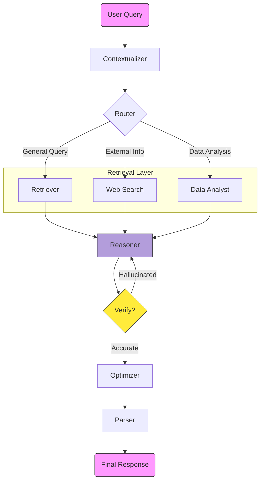

# Local Multi-Agent RAG System

> **A strictly local, privacy-focused, and free implementation of a sophisticated Agentic RAG system.**

This project orchestrates a team of specialized AI agents to answer complex queries using your local documents, web search, and data analysis tools. It is built on **LangGraph** and runs entirely on your machine using **Ollama** and **Qdrant**.

---

## Architecture & Workflow

The system is designed as a directed graph of autonomous agents. Each agent handles a specific cognitive task.



### The Agent Team

| Agent | Icon | Role |
|-------|------|------|
| **Contextualizer** | 🔄 | Refines the user's query by resolving pronouns (e.g., "it", "he") using chat history. |
| **Router** | 🚥 | Analyzes the intent to route the task: **RAG** (Internal Docs), **Web Search** (Live Internet), or **Data Analysis** (Python Code). |
| **Retriever** | 🔍 | Performs **Hybrid Search** (Vector + BM25) and uses a **Cross-Encoder** to rerank the top results for maximum relevance. |
| **Web Search** | 🌍 | Fetches real-time information using DuckDuckGo when internal docs are insufficient. |
| **Data Analyst** | 📊 | Writes and executes secure Python code (Pandas/Matplotlib) to analyze CSV/Excel files and generate insights. |
| **Reasoner** | 🧠 | Synthesizes the retrieved information into a coherent, fact-based answer. |
| **Verifier** | ✅ | (Optional) Cross-checks the Reasoner's valid claims against the source documents to prevent hallucinations. |
| **Optimizer** | ⚙️ | Logs feedback to improve future prompts (Self-Correction loop). |
| **Parser** | 📝 | Formats the final raw text into beautiful, readable Markdown (Executive Summary, Details, Key Takeaways). |

---

## Key Features

- **100% Local & Free**: Uses `Ollama` (Phi-3/Llama-3) and `SentenceTransformers` (`all-MiniLM-L6-v2`). No API costs.
- **Hybrid Retrieval**: Combines semantic search (embeddings) with keyword search (BM25) for best-in-class accuracy.
- **Deep Monitoring**: Watch every step of the agent's thought process in the "Live Execution Logs".
- **Self-Correction**: The `Verifier` agent can reject an answer and send it back to the `Reasoner` if it's not supported by facts.
- **Dynamic Formatting**: The `Parser` agent adapts the output format based on the complexity of your question.

---

## Getting Started

### Prerequisites
1.  **Python 3.10+**
2.  **Ollama**: [Download & Install](https://ollama.com/)
3.  **Pull the Model**:
    ```bash
    ollama pull phi3
    ```

### Installation

1.  **Clone the Repository**:
    ```bash
    git clone https://github.com/your-username/multi-agent-rag-local.git
    cd multi-agent-rag-local
    ```

2.  **Install Dependencies**:
    ```bash
    pip install -r requirements.txt
    ```

3.  **Setup Environment**:
    copy `.env.example` to `.env` (Defaults are usually fine for local run).

### Running the App

1.  **Start the UI**:
    ```bash
    streamlit run streamlit_app.py
    ```

2.  **Upload Documents**:
    - Open the Sidebar.
    - Upload PDFs, DOCX, MD, or TXT files.
    - Click **"Process Documents"**.

3.  **Chat**:
    - Ask questions like "Summarize the uploaded PDF" or "What is the policy?"
    - Toggle **"Enable Verifier"** for higher accuracy (slower) or disable it for speed.

---

## Configuration

Edit `app/config.py` or `.env` to customize:

- **`LLM_MODEL`**: Change to `llama3`, `mistral`, or `gemma` (ensure you pulled it in Ollama).
- **`EMBEDDING_MODEL`**: Change the HuggingFace model for vectorization.
- **`TOP_K`**: Adjust how many documents are retrieved (default: 5).

---

## Project Structure

A structured breakdown of the codebase:

```bash
multi_agent_rag_local/
├── app/
│   ├── agents/                 # 🤖 The Brains
│   │   ├── supervisor.py       # Orchestrates the entire workflow (LangGraph)
│   │   ├── retriever.py        # Handles Hybrid Search & Reranking
│   │   ├── reasoner.py         # Generates answers using the LLM
│   │   ├── web_search.py       # Interacts with DuckDuckGo
│   │   ├── data_analyst.py     # Executes Python code analysis
│   │   ├── router.py           # Routes queries to appropriate agents
│   │   ├── verifier.py         # Cross-checks answers against source documents
│   │   ├── optimizer.py        # Logs feedback for future tuning
│   │   ├── parser.py           # Formats the final raw text into beautiful, readable 
│   │   └── contextualizer.py   # Refines the user's query by resolving pronouns (e.g., "it", "he") using chat history.
│   │   └── base.py             # Base class for agents
│   │   └── summarizer.py       # Summarizes the retrieved documents
│   ├── rag/                    # 📚 The Knowledge Base
│   │   ├── ingestion.py        # File processing logic (PDF, DOCX, etc.)
│   │   ├── vector_store.py     # Qdrant client wrapper
│   │   ├── bm25_retriever.py   # In-memory keyword search
│   │   └── embeddings.py       # Embeddings logic
│   ├── models/                 # 🏗️ Data Structures
│   │   └── schemas.py          # Pydantic models (AgentState, Answer, etc.)
│   ├── api/                    # 🔌 Backend API
│   │   ├── chat.py             # Chat endpoints
│   │   └── upload.py           # File upload & reset endpoints
│   ├── prompts/                # 📝 Instructions
│   │   ├── parser.txt          # System prompts for agents
│   │   ├── retriever.txt       # System prompts for agents
│   │   ├── reasoner.txt        # System prompts for agents
│   │   ├── verifier.txt        # System prompts for agents
│   │   ├── optimizer.txt       # System prompts for agents
│   │   └── summarizer.txt      # System prompts for agents
│   ├── utils/                  # 📝 Instructions
│   │   └── logger.py           # Logger
│   ├── config.py               # Settings & Constants
│   └── main.py                 # FastAPI Entry Point
├── data/                       # 📂 Storage
│   └── uploaded_docs/          # Raw files uploaded by user
├── qdrant_data/                # Persistent vector database storage
├── streamlit_app.py            # 🖥️ Frontend UI (Streamlit)
├── requirements.txt            # Python Dependencies
└── .env                        # Secrets & Config
```

---

## Troubleshooting

- **"Ollama Connection Refused"**: Ensure Ollama is running (`ollama serve` or open the desktop app).
- **"Qdrant Error"**: If the vector DB gets stuck, click **"Reset Knowledge Base"** in the Sidebar to wipe it clean.

---

